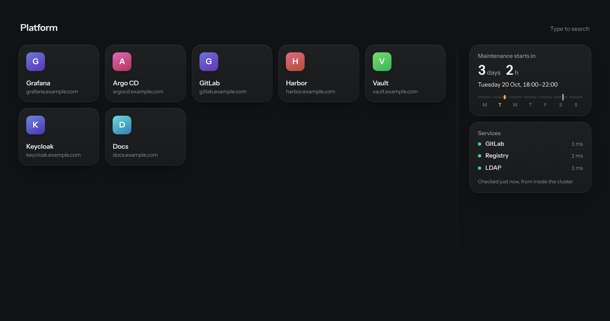

# view

A calm, read-only start page for a Kubernetes cluster: a board of tiles, one per website, with a
sidebar for the next maintenance window, service checks and the cluster's network facts, and a footer with
the versions of the platform's components.

<picture>
  <source media="(prefers-color-scheme: light)" srcset="docs/screenshot-light.png">
  
</picture>

- **Tiles from config or from routes.** List sites in the Helm values, or label an HTTPRoute and it gets
  a tile by itself. Both are merged, each link shown once.
- **Live.** Change the config or a route, and open pages update without a refresh or a pod restart.
- **Read-only.** No login, no editing in the browser, nothing stored. Everything comes from config.
- **Small.** One Go binary with the page embedded, a ~4 MB image running as non-root without a shell.

> **Built with AI.** view is "vibe coded": written with [Claude](https://claude.ai) from a conversation
> about what it should do, and reviewed, deployed and used daily by a human. The code, the chart and
> this README came out of that process. Issues and pull requests are welcome all the same.

## Install

```sh
helm install view oci://ghcr.io/glitchfactory-io/charts/view -n view --create-namespace -f my-values.yaml
```

With Flux, `examples/flux.yaml` has a Namespace, an `OCIRepository` and a `HelmRelease` with example
values. `charts/view/values.yaml` lists every option.

To publish the page through the Gateway API:

```yaml
httpRoute:
  enabled: true
  hostnames: [view.example.com]
  parentRefs:
    - name: gateway
      namespace: network
      sectionName: https
```

## Tiles

Everything the page shows comes from `config` in the Helm values, which the chart turns into a ConfigMap.
After an upgrade, open pages pick up the change by themselves, usually within a minute. That delay comes
from Kubernetes, which refreshes mounted ConfigMaps every so often.

```yaml
config:
  title: Platform        # the heading at the top of the page
  tiles:
    - name: Grafana
      url: https://grafana.example.com
    - name: Home Assistant
      url: http://192.168.1.20:8123
      icon: https://example.com/ha-logo.png   # optional
```

- **url** is required. Without `http://` or `https://`, `https://` is assumed.
- **name** is optional. If you leave it out, it's taken from the address (`nas.example.com` becomes "Nas").
- **icon** is optional. By default the server fetches each site's own icon; sites without one get a
  coloured letter.
- Tiles appear in the order listed.

**If the config has a mistake**, nothing breaks. The page keeps showing the last version that worked
and says at the top what's wrong and on which line.

## Cluster name and environment

For people who work with several clusters, the page can say which one it belongs to. Both values are free
text, and either can be left out:

```yaml
config:
  cluster:
    name: k8s-home
    environment: staging
```

They're shown below the heading, and at the start of the browser tab's title (`k8s-home · staging — view`),
so tabs of different clusters can be told apart. Leave the block out to show neither.

## Tiles from routes

Instead of listing a site under `tiles`, you can label its HTTPRoute and it gets a tile by itself.
Switch this on under `config`:

```yaml
discovery:
  enabled: true
```

Then label any route in the cluster:

```yaml
apiVersion: gateway.networking.k8s.io/v1
kind: HTTPRoute
metadata:
  name: grafana
  namespace: monitoring
  labels:
    view.glitchfactory.io/enabled: "true"            # quoted: label values are strings
  annotations:                                 # all optional
    view.glitchfactory.io/name: Grafana              # default: taken from the hostname
    view.glitchfactory.io/icon: https://example.com/logo.png
    view.glitchfactory.io/url: https://grafana.example.com/d/home   # default: https://<first hostname>/
spec:
  hostnames:
    - grafana.example.com
```

- The server reads the labelled routes every 30 seconds. New, changed and removed routes reach open pages without a refresh.
- Route tiles come after the tiles from `tiles`, sorted by name. Hover one to see which route it came from.
- **No duplicates.** Each link appears once. If a route points to a link that's already in `tiles`, the
  `tiles` entry wins (its name, icon and position). Two routes with the same link give one tile. Links count
  as the same when only `http`/`https`, letter case, a default port or a trailing `/` differ.
- A route whose only hostnames are wildcards (`*.example.com`) needs the `url` annotation; otherwise it's skipped.
- To use your own label, set `label: tiles.example.com/show`. The annotations then use the same
  prefix (`tiles.example.com/name`, and so on).
- With discovery on, the chart lets the service account read HTTPRoutes (all of them, as RBAC can't
  filter by label). If the routes can't be read, a note at the top of the page says why, and the
  route tiles that were already there stay until it's fixed.

## Maintenance window

The sidebar counts down to the next planned maintenance window. It's set under `config`, next to the tiles:

```yaml
maintenance:
  day: tuesday
  from: "18:00"
  to: "22:00"
  timezone: Europe/Berlin
```

While the window is running, the card turns amber and counts down to its end.
Leave the block out to hide the sidebar.

## Platform Services and network cards

Two more sidebar cards. The services are set up in the `platform:` block under `config`; the network card
is switched on with `network.enabled` in the Helm values.

**Platform Services:** can things running in this cluster reach the shared platform services your users
depend on (GitLab, Nexus, LDAP …)? Every minute the server checks each one from inside the cluster, so it
takes the same path a pod would: node, firewall, proxy, service. They're listed under `services:`.

```yaml
platform:
  certWarnDays: 21
  services:
    - name: GitLab
      url: https://gitlab.example.com/users/sign_in   # up = any answer below 500
    - name: Nexus
      url: https://nexus.example.com/service/rest/v1/status
      expect: 200                                      # health endpoints: require this status
      link: https://nexus.example.com/#browse          # where the name links to (optional)
    - name: Outside world
      url: https://www.example.com
      proxy: http://proxy.example.com:3128             # or: none, to go direct
      link: false                                      # nothing worth opening
    - name: LDAP
      tcp: ldap.example.com:636                        # not a web service: just connect
      tls: true                                        # and check its certificate
```

- A service only shows as down after two failed checks in a row, with the time it started failing.
- Each service shows `up`, `slow` (over 2 seconds), `down` or `checking` (before the first check). Hover it to
  see what's checked and how long the last check took.
- Certificates are read along the way: amber under `certWarnDays`, red under 7 days.
- Each name links to its tool, so the card doubles as a jump list. By default that's the root of the
  checked address (`https://nexus.example.com/`), since the check often hits a health endpoint or a login
  page. `link:` sets any other address, `link: false` leaves the name unlinked. `tcp:` checks have no link
  unless `link:` is set. Links open like tiles (Ctrl/Cmd-click or middle-click for a new tab).
- Without `proxy:`, checks follow the pod's own proxy settings (`HTTPS_PROXY`, `NO_PROXY`), if any.
- Certificates from an internal CA are trusted once the CA is in the image's trust store, or pointed to
  with the `SSL_CERT_FILE` environment variable.

**Network:** the IPs that matter for firewall and networking decisions.

- Ingress: the gateways' IPs. With Cilium's Layer 2 announcements, also the node that currently
  announces each one.
- Egress: the nodes' internal IPs, which is where pod traffic leaves from. Nodes that joined in the last
  week are marked, so allowlists can be updated in time.

The card is off by default, since not every cluster needs it. Switch it on in the Helm values:

```yaml
network:
  enabled: true
```

That's the only switch: the chart writes it into the config as `platform.network`, so don't set that one
yourself. Only with the card on does the chart give the service account the read-only permissions it needs
(gateways, nodes, services, and leases in `kube-system`, with `rbac.create: true`, the default). It can't
change anything or read Secrets.

## Platform versions

A footer row shows which versions of Kubernetes and the platform's own components run in the cluster, each
linking to its GitHub release. Switch it on in the Helm values:

```yaml
tooling:
  enabled: true
```

Nothing needs labelling or listing: view recognises components by their container images, however they were
installed (Flux, k3s, plain manifests). It knows:

| Component | Read from |
| --- | --- |
| Kubernetes | the API's version, shown short and named after the distribution: `k3s v1.36.3`, `RKE2`, `EKS`, `GKE` |
| Cilium, kgateway, CoreDNS, flux-operator, cert-manager, CloudNativePG, CSI NFS, metrics-server, kured | the image tag (Rancher's mirrored images count too) |
| Flux | its controllers' `app.kubernetes.io/version` label (the Flux release, not each controller's) |
| Gateway API | the `bundle-version` annotation on its CRD |

- Components that aren't in the cluster are simply left out. Workloads are never shown.
- During a rollout, both versions are shown (`v1.20.1 / v1.19.4`) until the old one is gone.
- Versions are re-read every 2 minutes.
- `hide` leaves components out, by id: `kubernetes`, `cilium`, `gateway-api`, `kgateway`, `coredns`, `flux`,
  `flux-operator`, `cert-manager`, `cloudnative-pg`, `csi-driver-nfs`, `metrics-server`, `kured`.
- `extra` adds components view doesn't know, by their image path (without tag). With `repo`, the badge links
  to that GitHub repo's release named like the image tag.

```yaml
tooling:
  enabled: true
  hide: [kured]
  extra:
    - name: BIND
      image: internetsystemsconsortium/bind9
      repo: isc-projects/bind9      # optional
```

Switching it on also gives the service account read access to Deployments, DaemonSets and StatefulSets (for their
images) and to the Gateway API's CRD (with `rbac.create: true`, the default). It can't change anything or read
Secrets.

## Using the page

- Click a tile to open it. Ctrl/Cmd-click or middle-click opens it in a new tab.
- **Type to search:** just start typing a name or address. The best match lights up; Enter opens it
  (Cmd/Ctrl+Enter in a new tab), Esc clears.
- Keys `1`–`9` open the first nine tiles. Add Shift to open in a new tab.
- Light and dark follow your device's setting by default. The switch at the top right picks light, dark or system; the choice is remembered in that browser. Each tile takes its accent color from the site's own icon.

## License

Apache License 2.0, see [LICENSE](LICENSE). The Instrument Sans font in `web/assets` is under the SIL Open
Font License, see `web/assets/instrument-sans-LICENSE.txt`.
